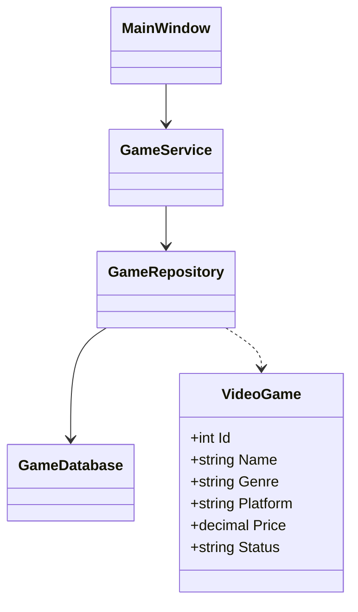

# GameStore — Gestor de videojuegos

**Estudiante:** [kevin daniel sanmiguel ortiz]  
**Asignatura:** Programación con C# y .NET  
**Tipo de proyecto:** Aplicación de escritorio

## 1. Información general

GameStore es una aplicación de escritorio para administrar una colección personal de videojuegos. Permite registrar títulos, consultar la colección, modificar sus datos y eliminar registros. La información se almacena en una base de datos SQLite para conservarla al cerrar la aplicación.

**Necesidad que resuelve:** facilita llevar un control organizado de los videojuegos, su género, plataforma, precio y estado de uso.

**Objetivo:** desarrollar una aplicación de escritorio que integre POO, interfaz gráfica con Avalonia UI y persistencia mediante ADO.NET y SQLite.

## 2. Funcionalidades

- Registrar videojuegos.
- Consultar la colección almacenada.
- Seleccionar un videojuego y cargar sus datos en el formulario.
- Actualizar la información de un videojuego.
- Eliminar un videojuego seleccionado.
- Validar campos obligatorios y precio.
- Conservar los registros después de cerrar y volver a abrir el programa.

## 3. Tecnologías utilizadas

- .NET 8
- C#
- Avalonia UI 11.2.3
- ADO.NET mediante `Microsoft.Data.Sqlite` 8.0.11
- SQLite
- XAML (`.axaml`)

## 4. Estructura del proyecto

```text
GameStore/
├── Data/
│   ├── GameDatabase.cs
│   └── GameRepository.cs
├── Models/
│   └── VideoGame.cs
├── Services/
│   └── GameService.cs
├── Views/
│   ├── MainWindow.axaml
│   └── MainWindow.axaml.cs
├── App.axaml
├── App.axaml.cs
├── Program.cs
├── GameStore.csproj
├── README.md
└── evidencias/
```

### Clases principales y responsabilidades

- **VideoGame:** representa un videojuego y sus propiedades: identificador, nombre, género, plataforma, precio y estado.
- **GameDatabase:** crea la conexión SQLite e inicializa la tabla.
- **GameRepository:** ejecuta las consultas SQL parametrizadas para registrar, consultar, actualizar y eliminar.
- **GameService:** contiene las validaciones y reglas de negocio.
- **MainWindow:** presenta la interfaz Avalonia y conecta los eventos de los controles con el servicio.

### Aplicación de POO

Se utilizan clases para representar y separar las responsabilidades del sistema. Las propiedades de `VideoGame` encapsulan los datos de cada videojuego. Los constructores inicializan los objetos y los métodos de `GameService` y `GameRepository` realizan operaciones específicas. La separación entre modelo, servicio, acceso a datos e interfaz facilita el mantenimiento del código.

### Relación entre componentes



## 5. Instalación de dependencias

### Requisitos

- .NET SDK 8.0 o superior compatible con el proyecto.
- Git.
- Linux, Windows o macOS con soporte para aplicaciones de escritorio Avalonia.

### Descargar el proyecto

Clona el repositorio (reemplaza la dirección por la URL real de tu repositorio):

```bash
git clone URL_DE_TU_REPOSITORIO
cd GameStore
```

### Restaurar dependencias

```bash
dotnet restore
```

Los paquetes NuGet se encuentran declarados en `GameStore.csproj`; no es necesario instalarlos manualmente.

## 6. Ejecución del programa

Desde la carpeta donde se encuentra `GameStore.csproj`, ejecuta:

```bash
dotnet run
```

La primera ejecución inicializa automáticamente la base de datos y la tabla de videojuegos.

## 7. Base de datos

La aplicación utiliza SQLite. La base de datos se crea automáticamente en la carpeta de datos locales del usuario, dentro de `GameStore/gamestore.db`.

### Tabla VideoGames

| Campo | Tipo | Descripción |
|---|---|---|
| Id | INTEGER | Identificador único autoincremental |
| Name | TEXT | Nombre del videojuego |
| Genre | TEXT | Género |
| Platform | TEXT | Plataforma |
| Price | REAL | Precio |
| Status | TEXT | Estado: Pendiente, Jugando o Completado |

La conexión se establece en `GameDatabase.cs`. Las operaciones CRUD se implementan en `GameRepository.cs` mediante comandos SQL parametrizados. `GameService.cs` valida los datos antes de enviarlos al repositorio.

## 8. Evidencias de funcionamiento

Guarda las capturas reales de tu aplicación en la carpeta `evidencias/`. No se deben usar imágenes simuladas: las capturas deben mostrar el programa ejecutándose.

| Archivo sugerido | Qué debe demostrar |
|---|---|
| `01-interfaz.png` | Ventana principal de GameStore |
| `02-registro.png` | Registro de un videojuego |
| `03-consulta.png` | Videojuego visible en la colección |
| `04-actualizacion.png` | Datos modificados |
| `05-eliminacion.png` | Registro eliminado |
| `06-validacion.png` | Mensaje al introducir datos incorrectos |
| `07-persistencia.png` | Registro que continúa disponible después de reiniciar |

## 9. Pruebas funcionales

Realiza estas pruebas y registra el resultado observado:

| Prueba | Acción | Resultado esperado |
|---|---|---|
| Registro | Agregar un videojuego con datos válidos | Se guarda y aparece en la lista |
| Consulta | Abrir o actualizar la lista | Se muestran los registros guardados |
| Actualización | Seleccionar un videojuego, cambiar un dato y actualizar | Se refleja el cambio |
| Eliminación | Seleccionar y eliminar un videojuego | Desaparece de la lista |
| Validación | Intentar guardar campos vacíos o precio inválido | Se muestra un mensaje y la aplicación continúa abierta |
| Persistencia | Cerrar y volver a ejecutar | Los registros anteriores siguen disponibles |

## 10. Problemas encontrados y soluciones

Durante el desarrollo se consideró la necesidad de evitar que los datos se perdieran al cerrar la aplicación. Para resolverlo se implementó SQLite mediante ADO.NET. La base de datos se inicializa automáticamente al iniciar el programa y los comandos SQL utilizan parámetros para enviar los datos del formulario de manera segura.

También se separaron las validaciones de la interfaz gráfica, ubicándolas en `GameService`, para mantener las responsabilidades organizadas.

---

**Nota para la entrega:** antes de publicar, reemplaza el nombre del estudiante, ejecuta todas las pruebas, agrega las capturas reales y coloca la URL pública de tu repositorio de GitHub en Moodle.
